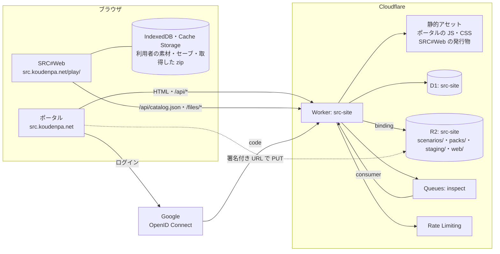
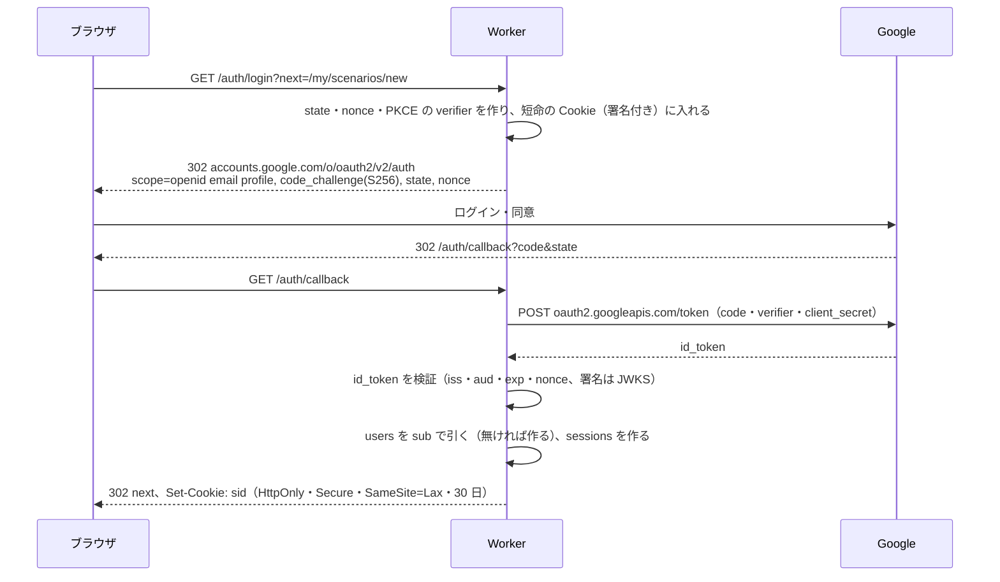
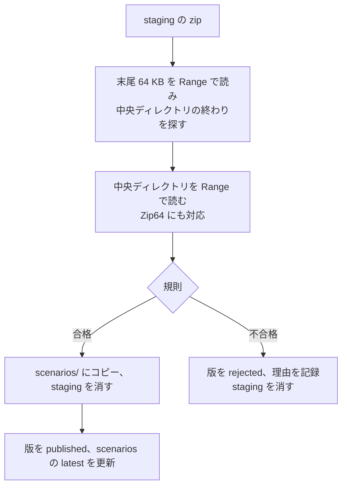

# SRC-Site 設計

[構成案](design.md) と [アセットの整理](assets.md) の方針で、具体的な構成を決める。

## 決めたこと

| 項目 | 決定 |
|---|---|
| ログイン | Google（OpenID Connect）。他の提供元は後で足せる形にする |
| 投稿の公開 | 運営の確認を挟まず、投稿したらすぐ公開する。内容は投稿者の自己責任 |
| 版権作品のシナリオ | 受け付ける。検閲しない。成人向けのシナリオは当面扱わない（年齢の区分は持たない） |
| グレーゾーンの素材 | 申し出があるまでは扱う。申し出があれば取り下げる |
| JASRAC 管理曲 | サイトでは配らない。利用者がブラウザに追加する |
| 汎用データの配布元への問い合わせ | 保留（グレーゾーンとして扱い、取り下げの仕組みで備える） |
| ドメイン | 本番 `src.koudenpa.net`。確認は本番の Worker のバージョン URL（`staging-src-site.koudenpa.workers.dev`） |

## 全体構成



- Worker は 1 つ。ポータルの画面（サーバーで HTML を作る）、API、ログイン、ファイルの配信、検査（Queues の consumer）をまとめる
- 実装は TypeScript と [Hono](https://hono.dev/)（Workers で動く小さな Web フレームワーク。JSX で HTML を作れる）。ポータルの画面はサーバーで描き、投稿の画面だけ少しの JavaScript を使う
- Workers Paid（月 $5）にする。1 要求の CPU が Free では 10 ms で、ID トークンの検証と zip の目次の解析に足りない（[Workers の制限](https://developers.cloudflare.com/workers/platform/limits/)）

## リポジトリの構成

```
src-site/
├─ src/
│  ├─ index.ts            # Hono のアプリ（fetch）と Queues の consumer（queue）
│  ├─ routes/             # pages.tsx・api.ts・auth.ts・files.ts・admin.ts
│  ├─ lib/                # oidc.ts・session.ts・zip.ts（中央ディレクトリの解析）・catalog.ts・presign.ts
│  └─ views/              # 画面の JSX
├─ public/                # ポータルの CSS・JS・画像（静的アセット）
├─ migrations/            # D1 のマイグレーション（0001_init.sql …）
├─ packs/                 # 共有パックの定義（JSON）と作る手順
├─ scripts/               # パックの登録、SRC#Web の組み立て
├─ docs/
├─ wrangler.jsonc
└─ .github/workflows/     # deploy.yml・packs.yml
```

- SRC#Web は 7474/SRC の版（タグかコミット）を指定して発行し、`dist/play/` に置く（src-host の deploy と同じ。発行物は SRC のコミットごとに Actions のキャッシュに置く）
- 25 MiB を超える発行物（AOT 後の `dotnet.native.wasm`）は R2 の `web/<SRCのコミット>/` に置き、Worker が返す

## パスと応答

### 方針

- 最上位の段は決まった語（下の表）だけにする。利用者が決める値（シナリオの slug・ハンドル・パックの ID）は必ず 2 段目以降に置く
- 同じ段に「利用者が決める値」と「決まった語」を並べない。作る・直す・消すは本人の区分（`/my/`）に置き、公開の区分（`/scenarios/:slug` など）の下に `new`・`edit` のような語を作らない。予約語は要らない
- 区分ごとに認証を揃える。HTML の画面はログインの状態を出すので、どの区分も `private, no-store`。共有のキャッシュに載せるのは `/api/catalog*`・`/files/`・静的アセット
- 資源の名前は英語の複数形（`scenarios`・`users`・`packs`・`versions`）
- 状態を変えるのは `POST` だけ。動詞（`delete`・`hide` など）は最後の段に置く
- HTML の画面と JSON の API（`/api/`）と不変のファイル（`/files/`）を分ける

### 最上位の区分

| 区分 | 中身 | 認証 | キャッシュ |
|---|---|---|---|
| `/`・`/scenarios/`・`/users/`・`/packs/`・`/about/` | 公開の画面 | 不要 | `private, no-store` |
| `/my/` | 本人の画面（設定・投稿・編集） | 要 | `private, no-store` |
| `/admin/` | 運営の画面 | 運営 | `private, no-store` |
| `/auth/` | ログイン | ― | ― |
| `/api/` | JSON（カタログ・投稿の API） | カタログは不要、投稿は要 | カタログは `public, max-age=60` |
| `/files/` | zip（版を含めて不変） | 不要 | `public, max-age=31536000, immutable` |
| `/play/` | SRC#Web（クロスオリジン分離） | 不要 | 静的アセット |
| `/static/` | ポータルの CSS・JS | 不要 | 静的アセット |

### 公開の画面

| パス | 内容 |
|---|---|
| `GET /` | 新着・検索（`?q=`。題名・作者・タグ・ハンドル） |
| `GET /scenarios/:slug` | シナリオの詳細（説明・版・必要なパック・プレイ・ダウンロード・通報のフォームへのリンク） |
| `GET /scenarios/:slug/download` | 最新版の zip（`Content-Disposition: attachment`） |
| `GET /users/:handle` | 投稿者の頁 |
| `GET /packs` | 共有パックの一覧 |
| `GET /packs/:id` | 共有パックの頁（出典・条件・取り下げの記録） |
| `GET /about/terms` | 規約 |
| `GET /about/rights` | 権利者の方へ（申し出の窓口・取り下げの記録） |
| `GET /play/?play=:slug` | SRC#Web でそのシナリオを始める |

### 本人の画面（`/my/`）

| パス | 内容 |
|---|---|
| `GET /my` `POST /my` | 設定（ハンドル・規約への同意）と自分のシナリオの一覧 |
| `GET /my/scenarios/new` `POST /my/scenarios/new` | シナリオを作る |
| `GET /my/scenarios/:slug` `POST /my/scenarios/:slug` | シナリオを直す・版を上げる |
| `POST /my/scenarios/:slug/delete` | シナリオを消す |
| `POST /my/versions/:id/settings` | 版の `root`・`eve` を直す |
| `POST /my/versions/:id/packs` | 版が使うパック（`requires`・`excludes`）を直す |
| `POST /my/versions/:id/delete` | 版を消す |

### 運営の画面（`/admin/`）

| パス | 内容 |
|---|---|
| `GET /admin` | 公開を止めているシナリオ・利用者の一覧、パックの取り下げ |
| `POST /admin/scenarios/:slug/hide` `POST /admin/scenarios/:slug/unhide` | 公開を止める・再開する |
| `POST /admin/users/:id/suspend` `POST /admin/users/:id/unsuspend` | 利用者を止める・戻す |
| `POST /admin/takedowns` | パック（のファイル）の取り下げを記録する |

### ログイン

| パス | 内容 |
|---|---|
| `GET /auth/login?next=` `GET /auth/callback` `POST /auth/logout` | Google のログイン |
| `GET /auth/dev` | ローカル開発だけ（`DEV_LOGIN`） |

### JSON とファイル

| パス | 内容 |
|---|---|
| `GET /api/catalog.json` | 公開中のシナリオと、それらが使うパックのカタログ |
| `GET /api/catalog/:slug.json` | 1 本のシナリオと、それが使うパックのカタログ（SRC#Web の `playCatalog`） |
| `POST /api/scenarios/:slug/versions` ほか | 投稿の API（下の「投稿」） |
| `GET /files/scenarios/:slug/:number.zip` | シナリオの版の zip（R2。Range・ETag） |
| `GET /files/packs/:id/:version.zip` | 共有パックの zip（R2。Range・ETag） |

- クロスオリジン分離（COOP・COEP）は `/play/` だけ。ポータルの画面は外部の画像（Google のアイコンなど）を出すので分離しない
- zip の URL は版を含めて不変にし、長くキャッシュする（版を変えると URL が変わる）

## ログイン（Google）



- 手順は [Google の OpenID Connect](https://developers.google.com/identity/openid-connect/openid-connect) に従う。利用者は `sub` で識別する（メールアドレスは変わりうるので鍵にしない）
- 持つ情報は `sub` と、初回に利用者が決める表示名（`handle`）だけ。メールアドレスと Google の名前・写真は保存しない
- 署名の検証は [jose](https://github.com/panva/jose)（Workers で動く）で、JWKS（`https://www.googleapis.com/oauth2/v3/certs`）をキャッシュして行う
- セッションは D1 の `sessions` に置き、Cookie には推測できない ID だけを入れる。状態を変える API は `Origin` を確かめる（SameSite=Lax と合わせて CSRF を防ぐ）
- 退会: 利用者を消すと、そのシナリオを非公開にし、R2 の zip を 30 日後に消す

## データ（D1）

```sql
-- 利用者
CREATE TABLE users (
  id          INTEGER PRIMARY KEY,
  provider    TEXT NOT NULL,              -- 'google'
  subject     TEXT NOT NULL,              -- id_token の sub
  handle      TEXT NOT NULL UNIQUE,       -- 表示名（URL にも使う）
  role        TEXT NOT NULL DEFAULT 'user', -- 'user' | 'admin'
  suspended   INTEGER NOT NULL DEFAULT 0,
  created_at  INTEGER NOT NULL,
  UNIQUE (provider, subject)
);

CREATE TABLE sessions (
  id          TEXT PRIMARY KEY,           -- 32 バイトの乱数
  user_id     INTEGER NOT NULL REFERENCES users(id),
  expires_at  INTEGER NOT NULL
);

-- シナリオ
CREATE TABLE scenarios (
  id             INTEGER PRIMARY KEY,
  slug           TEXT NOT NULL UNIQUE,    -- URL と SRC#Web の play に使う
  owner_id       INTEGER NOT NULL REFERENCES users(id),
  title          TEXT NOT NULL,
  author         TEXT,                    -- 作者の表記（投稿者と違ってもよい）
  description    TEXT,
  license        TEXT,                    -- 再配布の条件など、投稿者が書く
  tags           TEXT,                    -- JSON の配列
  visibility     TEXT NOT NULL DEFAULT 'public',  -- 'public' | 'unlisted' | 'hidden'（運営が止めた）
  latest_version INTEGER,
  created_at     INTEGER NOT NULL,
  updated_at     INTEGER NOT NULL
);

-- 版（zip ごと）
CREATE TABLE versions (
  id           INTEGER PRIMARY KEY,
  scenario_id  INTEGER NOT NULL REFERENCES scenarios(id),
  number       INTEGER NOT NULL,          -- 1, 2, 3…
  state        TEXT NOT NULL,             -- 'uploading' | 'inspecting' | 'published' | 'rejected' | 'withdrawn'
  r2_key       TEXT,
  size         INTEGER,
  etag         TEXT,                        -- 完了したときの R2 の ETag（カタログの版の識別。古い版は sha256）
  root         TEXT,                      -- zip の中のフォルダ
  eve          TEXT,                      -- 最初に実行する .eve
  requires     TEXT NOT NULL DEFAULT '[]', -- 共有パックの ID（JSON）
  excludes     TEXT NOT NULL DEFAULT '[]', -- 外すサイトの既定のパック（JSON）
  manifest     TEXT,                      -- 検査で得た目次の要約（JSON。ファイル数・展開後の大きさ・.eve・文書）
  refs         TEXT,                      -- 参照するアセットの名前（JSON。後の段階）
  inspect_note TEXT,                      -- 検査で弾いた理由
  created_at   INTEGER NOT NULL,
  UNIQUE (scenario_id, number)
);

-- 共有パック
CREATE TABLE packs (
  id          TEXT PRIMARY KEY,           -- 'src-graphic' など
  title       TEXT NOT NULL,
  source_name TEXT NOT NULL,              -- 配布元
  source_url  TEXT,
  license     TEXT NOT NULL,              -- 条件の要約
  is_default  INTEGER NOT NULL DEFAULT 0, -- 全シナリオに既定で重ねる
  priority    INTEGER NOT NULL DEFAULT 0, -- 重ねる順（大きいほど後＝優先）
  version     TEXT NOT NULL,              -- zip の版（sha256 の先頭など）
  r2_key      TEXT NOT NULL,
  size        INTEGER NOT NULL
);

-- 取り下げ（パックのファイル単位、シナリオの版単位）
CREATE TABLE takedowns (
  id          INTEGER PRIMARY KEY,
  target_type TEXT NOT NULL,              -- 'pack_file' | 'pack' | 'version' | 'scenario'
  target_id   TEXT NOT NULL,              -- パックの ID・パス、版の ID など
  reason      TEXT NOT NULL,
  requested_by TEXT,                      -- 申し出た人・団体
  created_at  INTEGER NOT NULL
);

-- 通報は Google フォームで受ける（D1 には置かない）

-- 遊んだ・ダウンロードした回数（人気の並びに使う）
CREATE TABLE counters (
  scenario_id INTEGER NOT NULL REFERENCES scenarios(id),
  day         TEXT NOT NULL,              -- 'YYYY-MM-DD'
  plays       INTEGER NOT NULL DEFAULT 0,
  downloads   INTEGER NOT NULL DEFAULT 0,
  PRIMARY KEY (scenario_id, day)
);
```

- 検索は最初は `title`・`author`・`tags` の `LIKE` で足りる。増えたら FTS5（D1 で使える）にする
- D1 は 1 データベース 10 GB まで（[D1 の制限](https://developers.cloudflare.com/d1/platform/limits/)）。zip や文書の中身は入れない

## ファイル（R2）

| キー | 中身 | 消す時期 |
|---|---|---|
| `staging/<uuid>.zip` | アップロード中・検査中の zip | 検査が済んだら移す。残ったものはライフサイクルで 1 日後に消す |
| `scenarios/<slug>/<number>.zip` | 公開した版 | 版を消したとき。退会・取り下げは 30 日後 |
| `packs/<id>/<version>.zip` | 共有パック | 新しい版を作り、古い版を参照するカタログが無くなってから |
| `web/…` | SRC#Web の 25 MiB を超える発行物（`/play/…` で静的アセットに無いとき返す） | 配信のたびに上書きする |

- 1 つのシナリオの zip は 1 GB まで（ロボッとダンジョンＢ！は約 270 MB）。投稿者ごとの合計は 5 GB まで（後で見直す）
- バケットの CORS は `https://src.koudenpa.net` と確認のバージョン URL（`https://staging-src-site.koudenpa.workers.dev`）に `PUT` だけを許す（[R2 の CORS](https://developers.cloudflare.com/r2/buckets/cors/)）

## 投稿

### API

| API | 内容 |
|---|---|
| `POST /api/scenarios/:slug/versions` | 版を作り、R2 のマルチパートアップロードを始める。要求: 大きさ。応答: `versionId`・`partSize`（32 MiB）・`parts`（パートの数） |
| `GET /api/versions/:id/parts/:n` | パートの上げ先。`url`（R2 のパートの署名付き URL、PUT、15 分。Secret が無ければ下の Worker）・`direct`・`length` |
| `PUT /api/versions/:id/parts/:n` | Worker を通してパートを上げる（R2 の S3 互換 API の鍵が無いとき）。応答: `etag` |
| `POST /api/versions/:id/complete` | パートの番号と ETag の一覧を渡し、マルチパートアップロードを完了する。大きさを確かめ、検査を Queues に積む |
| `GET /api/versions/:id` | 版の状態（検査中・公開・弾いた理由）。投稿の画面が数秒おきに見る |

シナリオの作成・変更・削除と版の設定は HTML のフォーム（`/my/`）で行う。

- zip は 32 MiB ずつのパートに分けて上げる（[マルチパートアップロード](https://developers.cloudflare.com/r2/objects/multipart-objects/)）。通信が切れたらそのパートだけ上げ直す（5 回まで）
- マルチパートアップロードの開始・完了と、パートの署名付き URL は Worker が [aws4fetch](https://github.com/mhart/aws4fetch) で R2 の S3 互換 API を呼んで作る（[署名付き URL](https://developers.cloudflare.com/r2/api/s3/presigned-urls/)）。アクセスキーは Worker の Secret に置く。キーには対象のバケットの **Object Read & Write** が要る（読み取りだけでは PUT が 403 になり、ブラウザには CORS のエラーとして見える）
- パートは Worker を通らないので、Workers の要求の大きさの制限（Free・Pro で 100 MB）や CPU 時間を使わない。ブラウザはパートの応答の `ETag` ヘッダを読む（バケットの CORS で見せている）
- パートのアップロードは書き込みの回数の制限に数えない（1 GB で 32 回）
- 1 日以上アップロード中のままの版は、cron がマルチパートアップロードを取りやめて片付ける

### 検査（Queues の consumer）



| 規則 | 内容 |
|---|---|
| .eve | 1 つ以上ある。`root`・`eve` の候補を出す（浅い階層の .eve、`README` の有無） |
| 大きさ | ファイル数 5 万まで、展開後の合計 3 GB まで、圧縮率 1:100 を超えるものを弾く（zip 爆弾） |
| パス | 絶対パス・`..`・ドライブ名を含むものを弾く |
| 実行ファイル | `.exe`・`.dll`・`.bat`・`.cmd`・`.vbs`・`.ps1`・`.scr`・`.msi`・`.com` を含むものを弾く |
| 暗号化 | 暗号化された項目を含むものを弾く（SRC#Web が展開できない） |
| ファイル名 | Shift_JIS と UTF-8 の名前を読む（SRC#Web の展開と同じ） |

- 中身の解凍はしない（Workers の CPU とメモリを使わないため）。中身のハッシュも計算しない。完了のときに `head` 1 回で、大きさが申告と一致するか、マルチパートの ETag の末尾のパートの数が合うかを確かめ、ETag を版に記録する（カタログの `version` に使う）
- 同じ規則（`src/lib/zip.ts`）を、アップロードの前にブラウザでもかける（`src/client/precheck.ts` を `scripts/assemble.sh` が `dist/static/precheck.js` に束ねる）。弾かれる zip は上げる前に分かる。Worker の検査は、ブラウザを通さない投稿に備えて残す
- 続けて、データとイベントを `srcsharp lint` と同じ検査と静的解析（`Call`・`Goto` の飛び先のラベル、include するファイル）にかける（7474/SRC の SRCLintWeb。スレッドを使わない WebAssembly で、`/lint/` に置く）。汎用データ（`Data/System` の `sp.txt` と `Lib` のイベント）は、そのシナリオが重ねるパックの zip から Range で読む。画像・音・マップの素材のファイルがあるかも、シナリオの zip と重ねるパックの zip の目次で確かめる（`assets: true`）。
- どこまで確かめるかは投稿者が選ぶ（投稿の画面の「上げる前の確かめ」。選んだものはブラウザの `localStorage` に残す）

  | 選択 | 動き |
  |---|---|
  | 問題があれば止める（既定） | エラー・警告があれば一覧を出し、「問題があっても上げる」を選ぶまで上げない |
  | 問題を表示して、そのまま上げる | 一覧を出して上げる。公開したあとも頁を移らず、一覧を残す |
  | 確かめない | lint をかけない |

  素材が見つからないこと（`info`）は一覧に出すだけで、どの選択でも止めない（素材を同梱せずに公開するシナリオは多い）。「素材のファイルがあるかも見る」を外せば確かめない。lint を読み込めないときは飛ばす
- 検査に通れば、運営の確認なしにすぐ公開する（決定のとおり）
- 参照するアセットの抽出（`refs`）は .NET が要るので、後の段階で GitHub Actions（`srcsharp`）か Cloudflare Containers で行う

## カタログ（SRC#Web との組み込み）

`GET /api/catalog.json` を D1 から作る。形は SRC#Web のカタログ（[外部のサイトに置く](https://github.com/7474/SRC/blob/master/docs/gui/web-hosting.md)）のまま。

```json
{
  "format": 1,
  "name": "SRC-Site",
  "entries": [
    {
      "id": "lantern",
      "title": "灯の巡航船ランタン号",
      "author": "…",
      "license": "CC0-1.0",
      "archive": "/files/scenarios/lantern/3.zip",
      "version": "3-1a2b3c4d",
      "root": "lantern",
      "eve": "01_灯の港.eve",
      "requires": ["src-basic", "src-graphic", "src-battle-anime", "src-sound"]
    },
    {
      "id": "src-battle-anime",
      "kind": "asset",
      "title": "汎用戦闘アニメ",
      "archive": "/files/packs/src-battle-anime/9f8e7d.zip",
      "version": "9f8e7d"
    }
  ]
}
```

- `requires` は「サイトの既定のパック（`is_default`）− 投稿者が外したもの（`excludes`）＋ 投稿者が足したもの（`requires`）」を、`priority` の順に並べる
- `/play/srcweb.json`: `title: "SRC-Site"`、`catalogs: ["/api/catalog.json"]`、`allowUserArchives: true`、`allowUserCatalogs: false`（他のサイトのカタログは読ませない）
- カタログが大きくなったら、`/api/catalog.json` は一覧用の軽いものにし、`?play=<slug>` で開くときは `/api/catalog/<slug>.json`（そのシナリオと要るパックだけ）を読む形にする（SRC#Web の変更）

## 共有パック

最初に用意するパック（[アセットの整理](assets.md) の「サイトで配る」もの）。

| ID | 中身 | 既定 | 出典 |
|---|---|---|---|
| `src-basic` | SRC# の最小の汎用データ（システムのデータ・地形・ユニットの代わり） | 既定 | SRC#（CC0） |
| `src-graphic` | `Bitmap/Map`・`Bitmap/Event`・`Lib/スペシャルパワー.eve` | 既定 | SRC 公式サイトの汎用データ（グラフィック集） |
| `src-battle-anime` | `Bitmap/Anime`・`Lib/汎用戦闘アニメ` | 既定 | 同（汎用戦闘アニメ） |
| `src-sound` | `Sound` | 既定 | 同（効果音集） |
| `soundfont` | MIDI の SoundFont（TimGM6mb、GPL-2.0） | 既定 | Debian のパッケージ |
| `gsc-graphic-marunage` | GSC の画像パック（丸投げ） | 投稿者が選ぶ | SRC 総合支援センター |
| `gsc-data` | GSC のデータパック（ロボ・拡張） | 投稿者が選ぶ | 同 |

- パックは `packs/<id>.json`（出典・条件・元の配布物の URL と sha256・取り出すパス）で定義し、`.github/workflows/packs.yml` が元の配布物を取ってきて zip を作り、R2 に置き、D1 の `packs` を更新する（src-host の upload-content と同じ形）
- 取り下げたファイル（`takedowns` の `pack_file`）は、zip を作るときに除く。版が変わるので SRC#Web は取り直す
- サウンドパック（GSC）・オリジナル BGM パック・JASRAC 管理曲は配らない。利用者が SRC#Web の「素材を追加」で入れる。ポータルのシナリオの頁と SRC#Web に、入手先の案内を出す

## 成人向けの内容

- 当面、成人向け（18 歳未満の閲覧に適さない）のシナリオは扱わない。規約で投稿を禁じ、通報を受けたら運営が公開を止める
- 年齢の区分・年齢の確認の機能は持たない（SRC#Web の `ratingConfirm` も使わない）

## 運営

| 機能 | 内容 |
|---|---|
| 通報 | Google フォームで受ける（サイトには通報の機能を持たない）。シナリオの頁と `/about/rights` からリンクし、シナリオの URL・題を事前入力する（`REPORT_FORM_URL`。docs/operations.md の「通報」） |
| 運営の画面 | シナリオの非公開（`hidden`。シナリオの頁から）と再開、版の取り下げ（`withdrawn`）、利用者の停止、パックのファイルの取り下げ |
| 取り下げの手順 | 権利者の申し出 → 非公開にする（即時）→ 投稿者に連絡（ポータル上の通知）→ 投稿者が直せば再公開。SRC 公式サイトのリンク集の対応に倣う |
| 窓口 | `/about/rights`（申し出の方法、対応の手順、取り下げた記録の公開） |
| 規約 | `/about/terms`。SRC 派生ソフトウェアの規約（形式 1）を含め、投稿時に同意を取る。内容の責任は投稿者にあることを明記する |

運営は最初は 1 人（`role = 'admin'`）。

## 濫用の対策

| 対象 | 対策 |
|---|---|
| 投稿 | 1 人 1 日 10 版、合計 5 GB まで（D1 で数える）。版の作成に Turnstile |
| API 全般 | [Rate Limiting](https://developers.cloudflare.com/workers/runtime-apis/bindings/rate-limit/) で、ログインしている人は `user:<id>`、していない人はパスごとに 60 秒あたりの回数を決める（数えるのは拠点ごとの近似） |
| ファイル | 検査の規則（上）。SRC#Web は .eve をブラウザの中で動かすだけで、同梱の HTML はスクリプトを動かさない枠で出す |

## SRC#Web の変更（7474/SRC）

| 変更 | 内容 |
|---|---|
| 利用者の素材を優先する | 利用者が追加した素材を `requires` の後に重ねる（今は先）。手元の BGM で差し替えられるように |
| 年齢の区分 | カタログの `rating` を見て、始める前に確かめる（`ratingConfirm` でオプトイン。このサイトでは使わない） |
| 1 本だけのカタログ | `?play=<slug>` のときに、そのシナリオだけのカタログ（`/api/catalog/<slug>.json`）を読めるようにする |
| 足りないアセットの表示 | 見つからなかった BGM・画像・効果音の名前を記録し、システムメニューから見られるようにする |
| 置き場所 | `/play/` に置く（`<base href="/play/">`）。発行時に書き換える |

## 配信と環境

| 環境 | ドメイン | 配信 |
|---|---|---|
| 本番 | `src.koudenpa.net`（Workers のカスタムドメイン） | `main` への push か手動 |
| 確認 | 本番の Worker のバージョン URL（`staging-src-site.koudenpa.workers.dev`・`pr-<番号>-src-site.koudenpa.workers.dev`） | PR か手動（`wrangler versions upload --preview-alias`） |

- 環境は本番の 1 つだけ。確認のバージョン URL は本番と同じ D1・R2・Queues を使う（[Version URLs](https://developers.cloudflare.com/workers/versions-and-deployments/version-urls/)）
- `.github/workflows/deploy.yml`
  1. 7474/SRC の指定の版で SRC#Web を AOT で発行する（キャッシュがあれば使う）
  2. `dist/` にポータルの静的ファイルと SRC#Web を置き、25 MiB を超えるものを R2 の `web/` に上げる
  3. 本番なら `wrangler d1 migrations apply` と `wrangler deploy`。確認なら `wrangler versions upload --preview-alias`（マイグレーションは当てない）
- Secrets: `CLOUDFLARE_API_TOKEN`・`CLOUDFLARE_ACCOUNT_ID`（Actions）、`GOOGLE_CLIENT_ID`・`GOOGLE_CLIENT_SECRET`・`SESSION_SECRET`・`R2_ACCESS_KEY_ID`・`R2_SECRET_ACCESS_KEY`・`TURNSTILE_SECRET`（Worker）
- Google の OAuth クライアントのリダイレクト URI に、本番と `staging` のバージョン URL の `/auth/callback` を登録する

## 監視とバックアップ

- Workers Logs で Worker のエラーを見る。SRC#Web のエラーは `srcweb.json` の `errorReporting`（Mackerel）で集める
- D1 は Time Travel（30 日まで戻せる）。R2 の `scenarios/` と `packs/` は消す前に 30 日置く（上の表）

## 費用の見積もり

| 項目 | 前提 | 月額 |
|---|---|---|
| Workers Paid | 基本料（要求 1,000 万回・CPU 3,000 万 ms を含む） | $5 |
| R2 | シナリオ 200 本 × 平均 100 MB ＋ パック 1 GB ≒ 21 GB。取り出しは無料 | 約 $0.2（10 GB の無料枠を超えた分） |
| D1・Queues | Paid の含まれる分で足りる | $0 |
| 合計 | | 約 $5〜6 |

## 段階

| 段階 | 内容 | できたと言える状態 |
|---|---|---|
| 1. 土台 | リポジトリの雛形、D1 のマイグレーション、R2、`deploy.yml` | 本番で空のポータルと `/play/` の SRC#Web が開く |
| 2. 閲覧と遊ぶ | 一覧・詳細・カタログ・ファイルの配信、共有パック（`src-basic`・`soundfont`）、運営がスクリプトで登録したシナリオ（ランタン号） | ランタン号をポータルから Web 版で遊べ、zip をダウンロードできる |
| 3. ログインと投稿 | Google のログイン、投稿の API と画面、検査、版の管理 | Google でログインして zip を上げると、数分以内に一覧に出て遊べる |
| 4. 運営 | 通報（Google フォーム）、運営の画面、取り下げ、規約と窓口の頁、Turnstile、回数の制限 | 通報からシナリオの非公開・パックのファイルの取り下げまでを画面でできる |
| 5. 汎用データ | `src-graphic`・`src-battle-anime`・`src-sound`・GSC のパックを登録し、既定に入れる | 汎用戦闘アニメを使うシナリオが追加の操作なしで動く |
| 6. 参照の照合 | `srcsharp` で参照するアセットを抜き出し、足りないものを詳細と SRC#Web に出す | シナリオの頁に「足りない BGM」が出る |
| 7. 本番 | `src.koudenpa.net` で公開 | ― |

SRC#Web の変更（上の節）は、2〜3 の段階で 7474/SRC に入れる。

## 保留していること

- 汎用データの配布元（SRC 公式サイトの汎用データコーナー）への問い合わせ。グレーゾーンとして扱い、取り下げの仕組みで備える
- Google 以外のログイン（Discord など）
- クラウドへのセーブデータの保存
- 投稿者の頁の充実（アイコン・紹介）、評価・コメント
