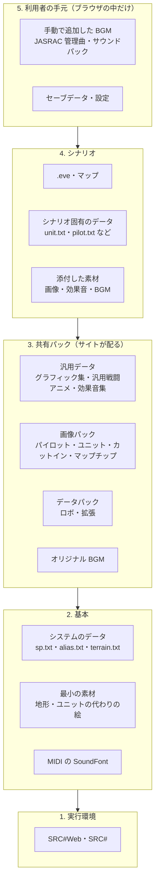
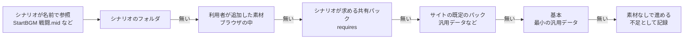

# プレイのための要素（アセット）の整理

シナリオを遊ぶのに要るもの（エンジン・データ・画像・効果音・BGM など）を体系立てて整理し、SRC-Site と SRC#Web で「シナリオを書いたら、アセットを名前でいい感じに参照できる」実行環境を作るための方針を決める。

## 前提（方針）

- 著作権的なグレーゾーン（配布条件がはっきりしない素材）は、権利者から申し出があるまでは扱う。そのかわり、申し出を受けたらすぐに外せる仕組みを最初から持つ（「取り下げ」の節）
- JASRAC 管理曲（版権作品の BGM の MIDI など）は、包括契約が現実的でないためサイトでは配らない。利用者が自分で用意して手元のブラウザに追加する前提にする
- 元の SRC と同じく「シナリオは名前で参照し、実体はプレイする人の環境にある」形を基本にする。SRC の素材の文化もこの形でできている（BGM や効果音は、シナリオに添付せずに「プレイヤーがパックを入れておく」ことが多い）

## 結論

- プレイの要素を **5 つの層** に分ける: 実行環境（SRC# 本体）、基本（システムのデータ・最小の素材）、共有パック（汎用データ・画像パック・データパック・BGM）、シナリオ、利用者の手元
- SRC#Web では、層ごとのパックを重ね、エンジンが名前で探す。探す順序は元の SRC と同じにする（シナリオ → 追加の素材 → 本体のフォルダ）
- サイトが配るのは「共有パック」まで。JASRAC 管理曲を含む BGM は「利用者の手元」の層に、利用者が一度入れれば全シナリオで使える形にする（SRC#Web の「素材を追加」をそのまま使う）
- **足りないアセットを見せる** 仕組みを作る。シナリオが参照する名前（BGM・画像・効果音）を一覧にし、どれが手元に無いかを遊ぶ前に示す。これが「いい感じに参照できる」の中心

## プレイの要素（体系）

### 種類ごとの一覧

| 種類 | 置き場所（SRC のフォルダ構成） | 形式 | 参照のしかた | 主な入手先 |
|---|---|---|---|---|
| イベント | シナリオのフォルダ | `.eve` | 起動時に選ぶ。`Include`・`Require` | シナリオ |
| マップ | シナリオのフォルダ | `.map` | `ChangeMap` | シナリオ |
| システムのデータ | `Data/System` | `sp.txt`（スペシャルパワー）・`alias.txt`・`terrain.txt`・`battle.txt`・`item.txt` | 起動時に読む（シナリオのものがあれば優先） | SRC 本体、SRC# の最小の汎用データ（CC0） |
| ユニット・パイロットのデータ | シナリオの `Data` など | `unit.txt`（`robot.txt`）・`pilot.txt`・`non_pilot.txt`・`pilot_message.txt`・`pilot_dialog.txt`・`animation.txt`・`effect.txt`・`item.txt` | 起動時にシナリオのフォルダから読む | シナリオ、GSC のデータパック（ロボ・拡張） |
| 共通のイベント | `Lib` | `スペシャルパワー.eve`・`汎用戦闘アニメ/include.eve`・`*ステータス表示.eve`・`Data/MELTライブラリ` | エンジンが自動で読む（シナリオ → ExtDataPath → ExtDataPath2 → 本体のフォルダの順） | 汎用データ、GSC のインクルード |
| パイロットの顔 | `Bitmap/Pilot` | `.bmp`・`.png` | `pilot.txt` の画像名 | 画像パック、シナリオ |
| ユニットの絵 | `Bitmap/Unit` | 同上 | `unit.txt` の画像名 | 画像パック、シナリオ |
| カットイン | `Bitmap/Cutin` | 同上 | 戦闘アニメ・イベント | 画像パック |
| 戦闘アニメの絵 | `Bitmap/Anime` | 同上 | 汎用戦闘アニメのイベント | 汎用戦闘アニメ |
| イベントの絵 | `Bitmap/Event` | 同上 | `PaintPicture` など | グラフィック集、シナリオ |
| マップチップ | `Bitmap/Map/<地形>/` | `<地形><番号>.bmp` | マップの地形と番号 | グラフィック集、画像パック |
| 効果音 | `Sound` | `.wav`・`.mp3` | `PlaySound`、武器・アビリティの効果音 | 効果音集、サウンドパック |
| BGM | `Midi` | `.mid`（同じ名前の `.mp3` があればそちらを使う） | `StartBGM`、ユニット・パイロットの「ＢＧＭ」、場面の既定の BGM | オリジナル BGM パック、サウンドパック、敷島の投稿 MIDI ページ（JASRAC 管理曲）、シナリオ |
| MIDI の音色 | 任意 | `.sf2`（SoundFont） | SRC#Web がシナリオ → 素材の順に探す | SRC#Web の素材（TimGM6mb など） |
| 文書 | シナリオのフォルダ | `README.txt`・`.md`・`.html` | SRC#Web の「文書」 | シナリオ |
| セーブデータ | シナリオのフォルダ | `.srcs`・`.srcq` | セーブ・ロード | 利用者（ブラウザの IndexedDB） |

- 場面の既定の BGM は名前で決まる。`Opening`・`Briefing`・`Subtitle`・`Intermission`・`Map1`〜`Map6`・`default` など（`Sound.BGMName`）。名前の解決は、`RenameBGM` で決めたもの → 設定（Src.ini の `[BGM]`）→ `<名前>.mid` の順
- 画像は名前だけで書くことが多い。エンジンは `Bitmap` の下の `Anime`・`Event`・`Cutin`・`Pilot`・`Unit`・`Map` を順に探す（SRCRender の `ImageCache`）
- 見つからない素材は、SRC# は止まらずに代わりの表示で進める（素材なしで実行。ユニットは文字の札で描く）

## 共有パックと条件

| パック | 配布元 | 中身 | 条件の要点 |
|---|---|---|---|
| 汎用データ（グラフィック集・汎用戦闘アニメ・効果音集） | [SRC 公式サイト](http://www.src-srpg.jpn.org/info_kiyaku.shtml) | `Bitmap/Map`・`Bitmap/Event`・`Bitmap/Anime`・`Lib`・`Sound` | 有償の配布は禁止。画像・汎用戦闘アニメの .eve は改変してシナリオに添付してよい。効果音は改変禁止 |
| 画像パック（丸投げ・非登録式・登録式） | [GSC 画像パック](http://gsc.ne.jp/materials_graphic.php) | パイロット・ユニット・カットイン・マップチップ（版権作品のもの） | 種類ごとに規約が違う。「丸投げ」は義務なし、「非登録式」「登録式」は ReadMe への作者名記載・リファインと削除への対応など |
| データパック（ロボ・拡張） | [GSC データパック](http://gsc.ne.jp/materials_data.php) | ユニット・パイロットのデータ（版権作品のもの） | シナリオに添付する場合は原則自由 |
| オリジナル BGM パック | [GSC オリジナル BGM](http://gsc.ne.jp/materials_bgm.php) | オリジナル曲の MIDI | 公開登録したシナリオでだけ使える。ReadMe とダウンロードページへの記載、ファイル名を変えない、第三者の再配布は禁止 |
| サウンドパック（旧ユーザー向け BGM パック＋拡張効果音パック） | [GSC サウンドパック](http://www.gsc.ne.jp/materials_bgm_user.php) | 版権作品の BGM（JASRAC 管理曲を除く）と効果音。約 177 MB | **シナリオ素材ではない。転載・再配布を禁止**。プレイヤーが `Midi`・`Sound` に入れて使う。シナリオの作者はプレイヤーに導入を促す |
| JASRAC 管理曲の MIDI | 敷島の投稿 MIDI ページ | 版権作品の BGM | サイトでは扱わない（利用者が手動で追加） |

- サイトで配る（グレーゾーンを含めて扱う）: 汎用データ、画像パック、データパック
- サイトで配らない: サウンドパック（再配布禁止が明記されている）、JASRAC 管理曲、オリジナル BGM パック（第三者の再配布を禁止）。いずれも利用者が自分で入手して手元に追加する
- SRC 本体の一部（`Data/System` など）は「無断配布禁止」なので配らない。SRC# の最小の汎用データ（CC0）で代わりにする

## 実行環境（SRC#Web）での参照

### 探す順序

- 今の SRC#Web: シナリオのフォルダと、素材（`requires`・利用者が追加した素材）を展開した本体のフォルダ（AppPath）の 2 段。利用者が追加した素材を先に、`requires` を後に展開するので、同じ名前なら `requires` が勝つ
- 変えたいこと: **利用者が追加した素材を `requires` より優先する**（利用者が手元の BGM で差し替えられるように）。展開の順を入れ替えるか、ExtDataPath に利用者の素材を置く
- 利用者が追加した素材は、ブラウザの IndexedDB に残り、全シナリオで使える（実装済み）。サウンドパックや JASRAC 管理曲の MIDI を一度入れれば、以後どのシナリオでも鳴る

### 足りないアセットを見せる

シナリオを書いた人も遊ぶ人も、何が足りないかを知る手段が今は無い。

| 段階 | 内容 |
|---|---|
| 参照の抽出 | シナリオの .eve とデータから、参照している名前を種類ごとに取り出す（`StartBGM`・ユニット・パイロットの「ＢＧＭ」、画像名、`PlaySound`、武器の効果音、`PaintPicture` など）。`srcsharp lint` の解析を使い、投稿時にサイトで一度行って結果を保存する |
| 照合 | 取り出した名前を、シナリオのフォルダ・共有パック・利用者の手元の順に照合する |
| 表示 | シナリオの詳細頁と SRC#Web の開始前に「足りないもの」を出す（例: BGM 12 曲中 3 曲が手元に無い）。JASRAC 管理曲などはファイル名と、入手先の案内（シナリオの README）を並べる |
| 実行中 | 見つからなかった名前を記録し、終わったときやシステムメニューから見られるようにする |

- 投稿者には「このシナリオが前提にするパック」を選んでもらい、カタログの `requires` に入れる。抽出した参照のうち、どのパックで足りるかをサイトが提案できるとよい

### パックの定義

カタログの素材（`kind: asset`）に、次の情報を足す。

| 項目 | 内容 |
|---|---|
| `source` | 配布元の名前と URL |
| `license` | 条件の要約（有償禁止・ReadMe への記載など） |
| `takedown` | 取り下げの状態（下の節） |

### 取り下げ

グレーゾーンを扱う代わりに、申し出に早く応じられるようにする。

- パック単位・ファイル単位で配布を止められる（D1 に止めたものの一覧を持ち、カタログと配信の両方で除く）
- パックの版を上げて止めたファイルを除いた zip を作り直す。SRC#Web はカタログの `version` で取り直す
- 止めたことをパックの頁に表示する（何が・いつ・誰の申し出で）
- 申し出の窓口を公開する。SRC 公式サイトのリンク集の対応（申し出 → 確認 → 5 日の猶予 → 削除）に倣う

## 課題

| 課題 | 内容 |
|---|---|
| 名前の衝突 | 別のパックに同じ名前のファイルがあると、どれを使うかは探す順で決まる。パックの重ね順を投稿者が決められるようにする |
| パックの大きさ | 汎用データだけで約 50 MB（展開後）、サウンドパックは約 177 MB。必要なものだけを取得する（BGM は使う曲だけ取る）仕組みが要る。SRC#Web は今 zip を丸ごと展開している |
| 大文字小文字・区切り | 元の SRC は Windows（大文字小文字を区別しない）。SRC# はパスの解決で吸収している（`PathResolver`） |
| BGM の形式 | MIDI は SoundFont で合成する。MP3 は再生できる。同じ名前の MP3 を優先する元の SRC の動きは実装済み |
| 参照の抽出の精度 | 変数で組み立てる名前（`StartBGM $(曲)` など）は静的に分からない。実行中の記録と組み合わせる |
| 利用者の手元の管理 | 追加した素材が増えると、ブラウザの容量（IndexedDB）を圧迫する。何を入れたかの一覧と削除は実装済み。容量の表示が要る |

## 進め方

1. 利用者が追加した素材の優先順位を `requires` より上にする（SRC#Web）
2. 参照の抽出（`srcsharp` に「参照するアセットの一覧」を出す機能を足す）
3. 足りないアセットの表示（SRC#Web の開始前・ポータルの詳細頁）
4. パックの定義（`source`・`license`）と取り下げの仕組み（SRC-Site）
5. 共有パックの登録: 汎用データ → 画像パック → データパック の順
