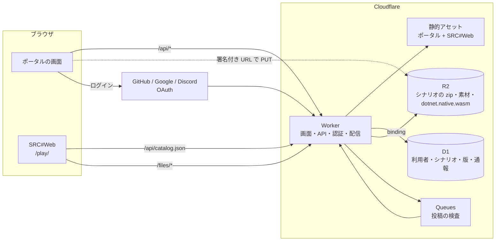
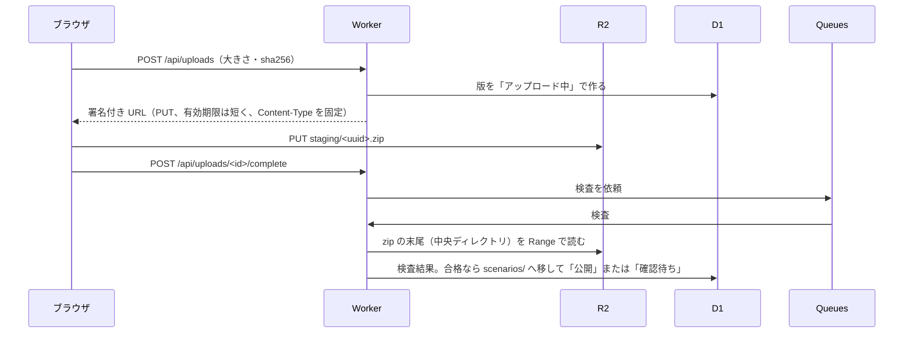

# SRC-Site 構成案

SRC#Web を組み込んだシナリオ投稿・配布ポータルを Cloudflare で動かすための構成と課題。

## 結論

- **構成**: Workers 1 つ（ポータルの画面・API・SRC#Web の静的ファイル・ファイル配信）＋ D1（利用者・シナリオの情報）＋ R2（zip と大きいファイル）。Workers Paid（月 $5〜）を前提にする
- **SRC#Web との組み込み**: SRC#Web は変えずに使える。ポータルの Worker が公開中のシナリオからカタログ（`catalog.json`）を作って返し、SRC#Web はそれを読む。シナリオの頁から `?play=<id>` で直接始める
- **投稿**: ブラウザから R2 へ直接アップロードし（Worker を通さないので 100 MB の制限を受けない）、Worker が zip の目次を読んで検査してから公開する
- **汎用戦闘アニメの同梱**: 技術的には、素材（`kind: asset`）として 1 つの zip にし、カタログで全シナリオの `requires` に入れれば済む。公式サイトの規約が認めるのは「改変してシナリオに添付すること」で、シナリオから離して全シナリオの基本として配ることは書かれていない。**デモシナリオへの添付で始め、基本として重ねるのは汎用データコーナーに確かめてから**（「権利」の節）
- **最大の課題は運営**。SRC 派生ソフトウェアの規約により、配布サイトは素材の無断添付や取り込み画像を扱えない。投稿の規約・通報・非公開化の手段を最初から用意する

BGM・画像などプレイのための要素の整理と、名前で参照する実行環境の方針は [アセットの整理](assets.md) にまとめた。

## 要件

| 区分 | 内容 |
|---|---|
| 閲覧者 | シナリオの一覧・検索・詳細を見る。Web 版（SRC#Web）ですぐ遊ぶ。zip をダウンロードして手元の SRC・SRC# で遊ぶ |
| 投稿者 | ログインして zip をアップロードし、題名・説明・作者・ライセンス・最初の .eve・必要な素材を登録する。版を重ねて更新する。非公開・削除する |
| 運営 | 通報を受ける、シナリオを非公開にする、投稿者を止める |
| Web 版の基本 | 汎用戦闘アニメ（と、許諾が取れれば汎用グラフィック集・効果音）を全シナリオに重ねる |

## 構成

### パスの割り当て

| パス | 中身 | ヘッダ |
|---|---|---|
| `/` `/s/<id>` `/u/<name>` | ポータルの画面（一覧・詳細・投稿者） | 通常 |
| `/play/` | SRC#Web（`<base href="/play/">`） | COOP `same-origin`・COEP `require-corp`（SRC#Web はマルチスレッドのため必須） |
| `/api/*` | JSON の API（ログイン・投稿・一覧・通報） | 通常 |
| `/api/catalog.json` | 公開中のシナリオから作るカタログ | CORP `same-origin` |
| `/files/scenarios/<id>/<version>.zip` | シナリオの zip（R2）。Range・ETag に対応 | CORP、`Content-Disposition`（ダウンロード時） |
| `/files/assets/<id>/<version>.zip` | 素材の zip（汎用戦闘アニメなど） | CORP |

- クロスオリジン分離が要るのは `/play/` だけにする。ポータルの画面は外部の画像（投稿者のアイコンなど）を読むため、分離しない
- SRC#Web の発行物のうち 25 MiB を超えるもの（AOT 後の `dotnet.native.wasm` 約 40 MB）は静的アセットに置けない（[Workers の制限](https://developers.cloudflare.com/workers/platform/limits/)）。src-host と同じく R2 に置き、Worker が返す

### SRC#Web との組み込み

SRC#Web の既存の仕組み（[外部のサイトに置く](https://github.com/7474/SRC/blob/master/docs/gui/web-hosting.md)）で足りる。

- `srcweb.json`: `catalogs: ["/api/catalog.json"]`。`allowUserArchives` は残してよい（手元の zip を遊ぶのは閲覧者のブラウザの中だけで、サイトには上がらない）
- カタログは Worker が D1 から作る。各エントリの `version` に zip のハッシュを入れる（SRC#Web はブラウザのキャッシュを `version` で判定するので、更新した版だけを取り直す）
- ポータルの「Web 版で遊ぶ」は `/play/?play=<id>` へのリンク
- 汎用戦闘アニメは `kind: asset` のエントリにし、カタログを作るときに全シナリオの `requires` に加える。投稿者が外す（戦闘アニメを使わない・自前で同梱する）こともできるようにする
- セーブデータは今と同じくブラウザ（IndexedDB）に残る。クラウドへの保存は後の課題

### 投稿の流れ

- **ブラウザから R2 へ直接上げる**。Worker が受けると、リクエストの大きさが Free・Pro で 100 MB に制限される（[Workers の制限](https://developers.cloudflare.com/workers/platform/limits/)）。ロボッとダンジョンＢ！は約 270 MB ある
  - 署名付き URL は S3 互換の API のドメインでしか使えず、ブラウザから使うにはバケットの CORS の設定が要る（[署名付き URL](https://developers.cloudflare.com/r2/api/s3/presigned-urls/)）
  - 代わりに R2 のマルチパートアップロードを Worker 経由で行う方法もある（1 回の要求を 100 MB 未満の部分に分ける）。途中からやり直せる利点がある。どちらにするかは実装時に決める
- **検査は zip を展開せずに行う**。zip の末尾の中央ディレクトリだけを Range で読めば、ファイルの一覧と展開後の大きさが分かる
  - .eve があるか
  - ファイル数・展開後の合計（zip 爆弾）
  - パスに `..` や絶対パスが無いか（SRC#Web の展開側でも防いでいる）
  - 実行ファイル（`.exe`・`.dll` など）が無いか
  - 文書（`README.txt` など）の有無
- 中身の検査（`srcsharp lint`）は .NET が要るので Workers では動かない。後の段階で [Containers](https://developers.cloudflare.com/containers/) か GitHub Actions に SRCDataLinter のイメージを置いて行う

### データ（D1）

| 表 | 主な列 |
|---|---|
| `users` | id、表示名、OAuth の提供元と ID、権限（投稿者・運営）、停止 |
| `sessions` | id、user_id、期限（Cookie は HttpOnly・Secure・SameSite=Lax） |
| `scenarios` | id（URL に使う短い名前）、owner、題名、説明、作者表記、ライセンス、公開状態、汎用戦闘アニメを使うか |
| `versions` | scenario_id、版、R2 のキー、大きさ、sha256、root、eve、requires、ファイル一覧の要約、検査結果、作成日時 |
| `reports` | 対象、理由、通報者、状態 |

- D1 は 1 つのデータベースが 10 GB まで（Paid）で、行の大きさは 2 MB まで（[D1 の制限](https://developers.cloudflare.com/d1/platform/limits/)）。zip の中身は D1 に入れない

### ログイン

- 公開のサイトなので Cloudflare Access（社内向けの仕組み）ではなく、Worker で OAuth を行う
- 提供元の候補: GitHub（開発者向け）、Google、Discord（SRC のコミュニティに合う）。最初は 1〜2 つにする
- 投稿だけにログインを要る。閲覧・プレイ・ダウンロードはログイン不要
- 投稿の連打を防ぐため、Turnstile と投稿の回数・容量の上限（例: 1 人 1 日 5 版・合計 2 GB）を置く

## 汎用戦闘アニメの同梱

### 大きさ（SRC フルパッケージ 2.2.33）

| 部分 | ファイル数 | 展開後 | zip |
|---|---|---|---|
| `Bitmap/Anime` | 14,945 | 約 32 MB | 約 8.8 MB |
| `Lib/汎用戦闘アニメ` | 77 | 約 3.0 MB | 約 0.4 MB |

- ダウンロードは約 9 MB で、ブラウザのキャッシュにより 2 回目からは取得しない
- 起動への影響: ロボッとダンジョンＢ！で、汎用戦闘アニメありはなしより約 3 秒遅い（zip はキャッシュ済み、src-host で計測）
- 1.5 万ファイルの展開はスマートフォンでは重い可能性がある。実機で測る

### 権利

フルパッケージ（srcall-2_2_33）に入っている基本データ・素材と、その条件。条件は [SRC 公式サイトの規約](http://www.src-srpg.jpn.org/info_kiyaku.shtml)（汎用データコーナーの「配布ファイルの使用に関する注意」）と、フルパッケージの `Readme.txt`・`フルパッケージ版内容.txt`・汎用戦闘アニメのマニュアルによる。

| 素材 | 中身（ファイル数・展開後） | 作者 | 条件 |
|---|---|---|---|
| 汎用戦闘アニメの画像 | `Bitmap/Anime`（14,945・32 MB） | 有志（汎用データコーナー） | 改変し、改変物をシナリオに添付・素材サイトへ投稿してよい。改変に元の作者の許可は要らない |
| 汎用戦闘アニメのイベント | `Lib/汎用戦闘アニメ`（77・3 MB） | 同上 | 同上（「汎用戦闘アニメ画像、eve ファイルは改変、及び改変物のシナリオへの添付・SRC 素材系サイトへ投稿を認めます」） |
| マップ画像・イベント用画像 | `Bitmap/Map`（7,376・6.6 MB）、`Bitmap/Event`（376） | 有志（グラフィック集） | 改変してローカル画像としてシナリオに添付してよい |
| スペシャルパワーアニメ | `Lib/スペシャルパワー.eve` | 有志（グラフィック集） | 個別の記載なし |
| 効果音 | `Sound`（254・8.7 MB） | 有志（効果音集） | 改変と、SRC 以外の用途のパッケージへの使用は禁止。添付の可否は記載なし |
| システムのデータ | `Data/System`（sp.txt・alias.txt・terrain.txt）、`Lib/*ステータス表示.eve`、`Bitmap/System(コピー元)`・`Bitmap/Unit` | SRC 本体（Kei 氏） | SRC 本体の一部として「無断配布禁止」 |
| 全体 | ― | ― | 素材集などとして有償で配ることは禁止 |

- 汎用データコーナーの素材はどれも、SRC で使っていると分かるスクリーンショット・動画として Web に載せてよい（引用）
- SRC 総合支援センターのデータパック（ユニット・パイロットのデータ）は「SRC シナリオに添付する場合においては原則自由」。それ以外の流用は、流用元をリンク付きで書く（[データパック](http://gsc.ne.jp/materials_data.php)）
- SRC# の最小の汎用データ（`SRC.Sharp/Content/basic-data`）は CC0 なので自由に配れる。システムのデータ（sp.txt など）はこちらで足りる

#### 同梱の形

| 形 | 内容 | 条件との関係 |
|---|---|---|
| A. 素材として全シナリオに重ねる | 汎用戦闘アニメ（とマップ画像など）を 1 つの素材の zip にし、カタログで全シナリオの `requires` に入れる | 規約が認めているのは「シナリオへの添付」。シナリオから離した素材集として配ることは書かれていない（禁じているのは有償の配布だけ）。**汎用データコーナーに確かめてから** |
| B. デモシナリオに添付して公開する | 汎用戦闘アニメなどを使うデモシナリオを作り、素材をそのシナリオに添付して公開する | 「シナリオへの添付」なので条件の範囲に収まる。ただし規約の文言は「改変して添付」「改変物の添付」で、改変しないまま添付してよいかは明記されていない |
| C. 各シナリオの作者が添付する | 投稿者が自分のシナリオに必要な素材を添付する | 規約の範囲に収まる（SRC の慣習どおり）。シナリオごとに同じ素材が重複し、閲覧者は毎回取得する |

- B は、そのデモシナリオを遊ぶ分には問題ない。しかし B のデモシナリオを A の素材として他のシナリオに重ねると、実質は A と同じになる
- 進め方: まず C と B で始める（ポータルの機能は変わらない）。並行して汎用データコーナー（乾氏。連絡は Twitter `drydog_jp` か公式サイトの連絡先）に、SRC#Web の基本として重ねて配ること（A）と、改変しない添付（B）の可否を確かめる
- 効果音は「添付」の記載が無いため、A・B のどちらで使うかも合わせて確かめる
- 許諾が取れるまでの代わりに、SRC# の最小の汎用データ（CC0）を Web 版の基本として重ねる。戦闘アニメは無いが、地形・ユニットの表示は足りる
- 汎用データを閲覧者が自分で追加する道も残す（SRC#Web の「素材を追加」。閲覧者のブラウザの中だけで使い、サイトには上がらない）

## 課題

### 権利・運営

| 課題 | 内容 | 対応案 |
|---|---|---|
| 派生ソフトウェアの規約 | SRC# は SRC 派生ソフトウェアとして規約（形式 1・2）を守る。配布サイトにも適用される: 許諾の無い素材の添付、取り込みの疑いのある画像、市販 CD から取り込んだ音楽、誹謗中傷などを扱わない | 投稿の規約にそのまま入れ、投稿時に同意を取る。通報と非公開化を用意する |
| 版権作品のシナリオ | 既存の SRC のシナリオには版権作品を扱うものが多い | 規約で扱いを決める（受け付けない、または運営が個別に判断する） |
| 素材の出典 | 開発パックの素材を添付する場合は、入手先と作者を書いた ReadMe を付ける慣習（サンプルシナリオの readme） | 投稿時に README の有無を検査して促す。SRC#Web は README を一覧の先頭に出せる |
| 削除の求め | 権利者からの削除依頼 | 連絡先と手順を公開し、運営が即時に非公開にできるようにする |
| 個人情報 | ログインで得る情報 | 表示名と提供元の ID だけを持つ。メールアドレスは持たない |

### 技術

| 課題 | 内容 | 対応案 |
|---|---|---|
| 大きいシナリオ | 数百 MB のシナリオは、スマートフォンでは取得・展開・起動が重い（ロボダンは zip のキャッシュ後でも約 50 秒で起動） | 一覧に大きさを出す。SRC#Web の読み込みの段階ごとの所要時間を測り、遅いところを直す |
| SRC#Web の版 | ポータルが使う SRC#Web をどの版にするか | src-host と同じく、7474/SRC の版（タグかコミット）を指定して発行し、発行物をキャッシュする |
| 投稿の検査 | Workers では中身の lint ができない | 第 1 段階は zip の目次の検査だけ。lint は後で Containers か GitHub Actions に置く |
| 悪意のある zip | zip 爆弾、パスの細工、実行ファイル | 目次の検査で弾く。SRC#Web は展開先の外を指すものを無視する。.eve はブラウザの中だけで動く。同梱の HTML はスクリプトを動かさない枠で出す |
| 費用 | R2 は 1 GB 月 $0.015、取り出しは無料（[R2 の料金](https://developers.cloudflare.com/r2/pricing/)）。Workers Paid は月 $5〜 | 100 本 × 平均 100 MB で 10 GB ≒ 無料枠の範囲。版を重ねる分は古い版を消すか IA に移す |
| Workers の CPU | Free は 1 要求 10 ms（[Workers の制限](https://developers.cloudflare.com/workers/platform/limits/)）。OAuth の署名・zip の目次の解析には足りない | Workers Paid にする |
| バックアップ | D1・R2 の誤削除 | D1 の Time Travel、R2 のバージョニングかライフサイクルの設定 |

### src-host との関係

- src-host（Basic 認証の内側の疎通確認）の Worker の処理（クロスオリジン分離のヘッダ、R2 の Range・ETag 配信、SRC#Web の発行とキャッシュ）はそのまま使える
- src-host の汎用データ（`src-data.zip`）は再配布の許諾を得ていないため、公開のポータルに移さない

## 進め方

| 段階 | 内容 |
|---|---|
| 1. 下地 | 汎用データコーナーに、基本として重ねる配り方と改変しない添付の可否を確かめる。投稿の規約を書く。ドメインを決める |
| 2. 閲覧と遊ぶ | Worker・D1・R2 を用意し、運営が手で登録したシナリオ（ランタン号、汎用戦闘アニメのデモシナリオなど）をポータルの一覧・詳細・Web 版・ダウンロードで出す |
| 3. 投稿 | OAuth のログイン、R2 への直接アップロード、zip の目次の検査、版の管理、非公開・削除 |
| 4. 運営 | 通報、運営の画面、投稿の上限、Turnstile |
| 5. 拡張 | lint の自動実行、汎用戦闘アニメの同梱（許諾が取れたら）、検索・タグ、セーブデータのクラウド保存 |

## 決めたこと

具体的な構成は [設計](architecture.md) にまとめた。

| 項目 | 決定 |
|---|---|
| ログイン | Google から始める |
| 投稿の公開 | 運営の確認を挟まない（自己責任） |
| 版権作品のシナリオ | 受け付ける。検閲しない。年齢の区分を付ける |
| 汎用データの配布元への問い合わせ | 保留 |
| ドメイン | 本番 `src.koudenpa.net`、確認環境 `*.workers.dev` |
