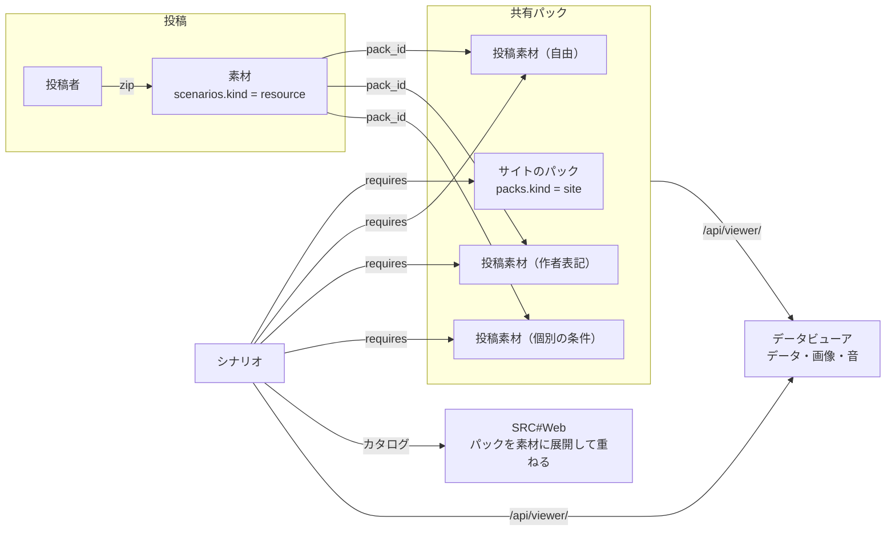

# 素材の投稿と閲覧（管理コンテンツ）

JASRAC 管理曲を除いた SRC 関連の素材（画像・効果音・BGM・データ）を、投稿・管理・閲覧できるようにする（[7474/SRC-Site#17](https://github.com/7474/SRC-Site/issues/17)）。方針は [アセットの整理](assets.md) の「前提」に従う。

## 結論

- 素材は **管理ポリシーの違う共有パック** に投稿する。SRC の素材の慣習（GSC の画像パックの「丸投げ」「非登録式」など）に倣い、ポリシーはパックごとに 1 つ決める
- シナリオの投稿者は、今までのサイトのパックと同じく **パックの単位で選ぶ**。SRC#Web のカタログでは、パックを中の素材に展開して重ねる
- 閲覧は **データビューア（7474/SRC の SRCTestBlazor）を拡げる**。サイトが公開している zip（シナリオ・素材・パック）を一覧にし、データ・画像・音を zip ごとに見られる。データから参照していない画像・音も見られる
- JASRAC 管理曲は扱わない（規約で投稿を禁じる）。それ以外のグレーゾーンの素材は扱い、申し出があれば取り下げる



## 管理ポリシー

| パック | ポリシー | 内容 | 素材ごとの条件 |
|---|---|---|---|
| `user-free` 投稿素材（自由） | 自由（丸投げ） | 利用・改変・再配布（シナリオへの添付、ほかの素材サイトへの投稿を含む）を、条件を付けずに誰にでも認める | 任意 |
| `user-credit` 投稿素材（作者表記） | 作者表記（非登録式） | 利用・改変・シナリオへの添付を認める。使う人はシナリオの ReadMe などに作者名と素材の頁の URL を書く | 任意 |
| `user-individual` 投稿素材（個別の条件） | 個別の条件 | 素材ごとの「ライセンス・配布の条件」に従う。SRC#Site でシナリオと一緒に読み込んで遊ぶことは認める | 必須 |

- ポリシーの文言は `src/lib/policy.ts`、パックの行は `migrations/0007_resource_packs.sql` にある。パックを足すときは `packs` に `kind = 'community'` の行を足す
- 投稿するときと、投稿先のパックを変えるときに、ポリシーへの同意を取る
- どのパックも既定（`is_default`）にしない。サイトのパックより後に重ねる（`priority` 100〜）ので、同じ名前のファイルは投稿素材が勝つ

## 投稿

素材の投稿はシナリオと同じ表と流れを使う（[設計](architecture.md) の「投稿」）。

| 項目 | シナリオ | 素材 |
|---|---|---|
| 表 | `scenarios`（`kind = 'scenario'`） | `scenarios`（`kind = 'resource'`、`pack_id` に投稿先） |
| 作る | `/my/scenarios/new` | `/my/resources/new`（パックとポリシーへの同意） |
| 版・アップロード・検査 | `/my/scenarios/:slug`、`/api/scenarios/:slug/versions` ほか | 同じ |
| 検査（`inspect(entries, kind)`） | .eve が要る | .eve は要らない。種類ごとのファイルの数（`manifest.media`）を数える。実行ファイル・パス・大きさの規則は同じ |
| `root` | 全体が 1 つのフォルダに入っていればそのフォルダ | 同じ。ただし `Bitmap`・`Sound`・`Midi`・`Music`・`Data`・`Lib` そのものなら root にしない |
| lint | 上げる前にかける | かけない |
| 公開の頁 | `/scenarios/:slug` | `/resources/:slug`（互いに転送する） |
| 一覧 | トップの新着・人気・検索 | 出さない。パックの頁・投稿者の頁・設定の頁に出す |
| zip | `/files/scenarios/:slug/:number.zip` | `/files/resources/:slug/:number.zip`（R2 のキーは `scenarios/<slug>/<number>.zip` のまま） |

- 投稿の回数・合計の大きさの上限はシナリオと合わせて数える
- 公開（`public`）と限定公開（`unlisted`）の素材はパックに入る。非公開（`private`）と運営が止めたもの（`hidden`）は入らない
- 運営の非公開・再開（`/admin/scenarios/:slug/hide`）は素材にも使える

## カタログ（SRC#Web）

- `selectPacks`: シナリオが重ねるパック（既定 − 外したもの ＋ 足したもの、`priority` の順）。シナリオの頁に出す
- `resolveRequires`: カタログの `requires`。投稿素材のパックを中の素材（`resource.<slug>`）に展開する
- パックの中の素材は、新しく投稿したものを先に、先に投稿したものを後ろに並べる。SRC#Web は後ろほど優先するので、同じ名前のファイルは **先に投稿された素材** が使われる（後から同じ名前で上げて差し替えることはできない）
- 素材のカタログの項目は `kind: asset`。`version` は版の番号と R2 の ETag で、版を上げると SRC#Web が取り直す

```json
{
  "id": "lantern",
  "requires": ["src-basic", "src-graphic", "resource.new-faces", "resource.old-faces"]
},
{ "id": "resource.old-faces", "kind": "asset", "archive": "/files/resources/old-faces/2.zip", "version": "2-1a2b3c4d5e6f" }
```

lint（投稿の画面）とチェッカー（`/check`）が汎用データを読む zip も、同じ展開で決める（`archiveUrls`）。

## 閲覧（データビューア）

データビューアは `/viewer/viewer.json`（`scripts/assemble.sh` が書く）で `/api/viewer/index.json` を読み、サイトの zip を一覧にする。形は [7474/SRC の docs/gui/dataviewer.md](https://github.com/7474/SRC/blob/master/docs/gui/dataviewer.md)。

| パス | 内容 | キャッシュ |
|---|---|---|
| `GET /api/viewer/index.json` | 公開のシナリオ・パックに入っている素材・パックの一覧。シナリオは `requires`（展開したもの）、投稿素材のパックは `members` を持つ | `public, max-age=60` |
| `GET /api/viewer/archives/<種類>/<ID>/<版>.json` | zip の中のファイルの一覧（`{ files: [{ path, size }] }`）。種類は `scenarios`・`resources`・`packs` | 不変（Cache API にも置く） |
| `GET /files/<種類>/<ID>/<版>/<zip の中の道>` | zip の中のファイルを 1 つ取り出して返す。区切りと大文字小文字は区別しない。Range に応じる | 不変（Cache API にも置く） |

- 取り出しは zip の目次を Range で読み、目当ての項目だけを Range で読んで展開する（`src/lib/archives.ts`。展開は `DecompressionStream`）。32 MB を超えるファイルは取り出さない（413）
- 返す種類は画像（BMP・PNG・JPEG・GIF）と音（WAV・MP3・OGG・MIDI）だけ。ほかは `application/octet-stream` と `Content-Security-Policy: sandbox` で返し、投稿された HTML・SVG を同じオリジンで動かさない
- 見せる範囲は zip の配信と同じ（公開・限定公開で、運営が止めていない、検査を通った版。パックは取り下げていないもの）。一覧に出すのは公開のシナリオだけ
- ポータルの頁（シナリオ・素材・パック）から「データビューアで見る」で開く（`/viewer/archive?id=<ID>`）

## 取り下げ

- 素材: 運営がシナリオと同じく公開を止める（`hidden`）。パックからも、カタログ・ビューアの一覧・ファイルの配信からも外れる
- サイトのパックのファイル: 今までどおり `takedowns` に記録し、パックを作り直す（[設計](architecture.md) の「共有パック」）

## 残していること

| 課題 | 内容 |
|---|---|
| MIDI の再生 | データビューアでは MIDI を鳴らせない（ダウンロードの案内だけ）。SRC#Web と同じく SoundFont で合成する（MeltySynth）か、SRC#Web の再生を使う |
| 参照の照合 | データビューアの「データで使用」は、そのアーカイブのデータ（ユニット・パイロットの画像）だけを見る。素材が、どのシナリオから使われているかは出さない。イベント（.eve）の参照は [アセットの整理](assets.md) の「足りないアセットを見せる」と合わせて行う |
| 名前の衝突 | パックの中で同じ名前のファイルを持つ素材を、投稿のときに知らせる |
| 大きいパック | サイトのパック（汎用戦闘アニメは約 1.5 万ファイル）の目次は約 1 MB。最初の 1 回は Worker が目次を読み、CPU を使う |
| 素材の検索 | 素材はトップの検索に出さない。素材が増えたら、パックの頁かデータビューアに検索を足す |
