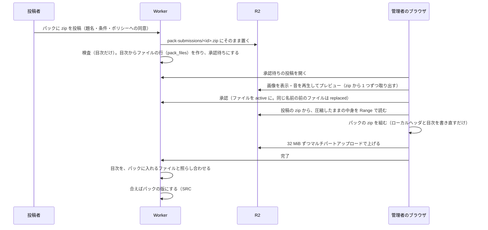

# 素材の投稿と閲覧（管理コンテンツ）

JASRAC 管理曲を除いた SRC 関連の素材（画像・効果音・BGM・データ）を、投稿・管理・閲覧できるようにする（[7474/SRC-Site#17](https://github.com/7474/SRC-Site/issues/17)）。方針は [アセットの整理](assets.md) の「前提」に従う。

## 結論

- 利用者は **共有パックを作れる**。パックごとに管理ポリシーを 1 つ決める（SRC の素材の慣習。GSC の画像パックの「丸投げ」「非登録式」など）
- 素材は **パックに zip でまとめて投稿** し、**パックの管理者がプレビューして承認** する。承認したファイルはパックの中身に入る。同じ名前のファイルは新しく承認したものに差し替わる
- パックは **1 つの zip** として配る。zip は **承認者のブラウザが組む**（投稿の zip から圧縮したままの中身を写す）。Worker は上がった zip の目次を確かめるだけで、展開も圧縮もしない
- シナリオは今までのパックと同じく、パックの単位で選ぶ。SRC#Web のカタログでは、パックは 1 つの `kind: asset` の項目
- 閲覧は **データビューア（7474/SRC の SRCDataViewer）を拡げる**。サイトが公開している zip（シナリオ・パック）を一覧にし、データ・画像・音を見られる。データから参照していない画像・音も見られる
- JASRAC 管理曲は扱わない（規約で投稿を禁じる）。それ以外のグレーゾーンの素材は扱い、申し出があれば取り下げる

## パックと管理者

| 種類（`packs.kind`） | 作る人 | 中身 | zip |
|---|---|---|---|
| `site` | 運営（`packs/<id>.json` と packs ワークフロー） | 配布物から取り出したもの | ワークフローが作る |
| `community` | 利用者（`/my/packs/new`）。運営が用意したもの（`user-free`・`user-credit`・`user-individual`）もある | 承認した投稿のファイル | 承認者のブラウザが組む |

- 管理者は `pack_managers` に持つ（作った人は `role = 'owner'`）。今は作った人だけが管理者になる。ほかの人を管理者に足す画面は後で作る（表はそのまま使える）
- 運営（`users.role = 'admin'`）は、すべてのパックを管理できる。運営が用意したパック（`owner_id` が NULL）の管理者は運営だけ
- 投稿を受け付ける相手（`accepts`）: `anyone`（だれでも投稿でき、管理者が承認する）・`managers`（管理者だけが投稿する）
- 利用者のパックは既定（`is_default`）にしない。`priority` はサイトのパックより後（運営のもの 100〜、利用者のもの 200）なので、同じ名前のファイルは利用者のパックが勝つ
- 一度も zip に反映していないパック（`r2_key` が空）は、シナリオから選べず、カタログ・データビューアにも出ない

### 管理ポリシー

| ポリシー | 内容 | 投稿ごとの条件 |
|---|---|---|
| 自由（丸投げ） `free` | 利用・改変・再配布（シナリオへの添付、ほかの素材サイトへの投稿を含む）を、条件を付けずに誰にでも認める | 任意 |
| 作者表記（非登録式） `credit` | 利用・改変・シナリオへの添付を認める。使う人はシナリオの ReadMe などに作者名とパックの頁の URL を書く | 任意 |
| 個別の条件 `individual` | 投稿ごとの「ライセンス・配布の条件」に従う。SRC#Site でシナリオと一緒に読み込んで遊ぶことは認める | 必須 |

ポリシーの文言は `src/lib/policy.ts`。パックを作るときに決め、後から変えられない。投稿するときに同意を取る。

## 投稿

| 項目 | 内容 |
|---|---|
| 画面 | `/my/packs/:id/submit`（パックの頁の「このパックに投稿する」） |
| zip | SRC のフォルダの形（`Bitmap/…`・`Sound/…`・`Midi/…`・`Data/…`）。フォルダごと zip にしてもよい（`root`。`Bitmap` などそのものは root にしない） |
| アップロード | シナリオの版と同じマルチパートアップロード（`src/lib/multipart.ts`・`public/uploader.js`）。上限（1 日 10 回・合計 5 GB）はシナリオの版と合わせて数える |
| 検査 | シナリオと同じ規則（`inspect(entries, 'resource')`）。ただし .eve は要らない。名前が大文字小文字を区別せずに重なるもの、無圧縮・deflate 以外の圧縮は弾く |
| ファイルの行 | 検査に通ったら、目次からファイルごとに `pack_files`（道・大きさ・CRC32・圧縮の方式・投稿の zip の中の位置）を作る。zip は展開しない |
| 状態 | `uploading` → `inspecting` → `pending`（承認待ち）→ `approved`・`rejected`（却下・検査で弾かれた）・`withdrawn`（投稿者が取り下げた）・`retired`（ファイルがすべて差し替わった・外れた） |

## 承認とプレビュー

- `/my/submissions/:id`: 投稿の中身。画像を並べ、音を鳴らし、ファイルの一覧を出す。パックにすでにある同じ名前のファイルは「差し替え」と出す
- 投稿の頁から「データビューアで見る・聞く」で、承認前の投稿もデータビューアで開ける（`/viewer/archive?index=/api/viewer/submissions/:id/index.json&id=submission-:id`）。データの表示・MIDI の再生ができ、画像は投稿先のパックと重ねて探す
- プレビューのファイルは `/files/pack-submissions/:id/<道>`（zip から 1 つ取り出す）。投稿の zip は `/files/pack-submissions/:id.zip`（Range）。どちらも投稿した人と、パックの管理者・運営だけが読める（`Cache-Control: private`）
- 承認すると、その投稿のファイルを `active` にし、同じ道（大文字小文字を区別しない）の前のファイルを `replaced` にして、パックの `revision` を上げる。続けて管理の頁で zip への反映を始める
- 管理者はファイルを外せる（道を指定するか、投稿ごと）。外すと `revision` が上がる

## 投稿の状態（投稿した人への知らせ）

メールなどでは知らせない。投稿した人は画面で状態を見る。

| 画面 | 出すもの |
|---|---|
| `/my` の「パックへの投稿」 | 投稿ごとの状態（承認待ち・承認・却下など）、投稿・承認・却下の日時、承認したものが zip に入っているか、却下の理由・検査で弾かれた理由 |
| `/my/submissions/:id` | 状態の説明（検査中・承認待ち・承認（日時・承認者・zip に入っているか）・却下（日時・承認者・理由）・検査で弾かれた理由・取り下げ・差し替え済み） |

## zip への反映（承認者のブラウザ）

| 段階 | 内容 |
|---|---|
| 組むもの | `GET /api/packs/:id/plan`: `revision`、組んだ zip の大きさ、パックに入れるファイル（道・大きさ・CRC32・圧縮の方式・投稿の zip の URL と位置） |
| 組む | `src/client/packbuild.ts`（`/static/packbuild.js`）。投稿の zip を前から 8 MiB ずつ Range で読み、各項目の圧縮したままの中身を写す。ローカルヘッダと中央ディレクトリは新しく書く（名前は UTF-8、日時は 1980-01-01 で固定） |
| 上げる | `POST /api/packs/:id/builds`（`revision` と大きさを確かめる）→ 組んだものを 32 MiB ずつのパートで上げる → `POST /api/pack-builds/:id/complete` |
| 確かめる | Worker が上がった zip の中央ディレクトリを読み、パックに入れるファイルと、名前・大きさ・圧縮後の大きさ・CRC32・圧縮の方式が一致し、項目がすき間なく並んでいる（ほかのデータを挟んでいない）ことを確かめる（`verifyPackZip`）。組んでいるあいだに `revision` が変わっていれば断る |
| 版にする | 合えば `packs.version`（`<組み直しの ID>-<ETag の先頭>`）・`r2_key`・`size`・`built_revision` を更新する。前の版の zip は 1 つ残し、それより古いものを消す。ファイルが 1 つも残っていない投稿の zip も消す |

- Zip64 は使わない。パックは 65,535 ファイル・4 GB まで
- 承認の後に頁を閉じても、承認したものは残る。管理の頁に「zip に未反映」と出るので、そこからやり直す
- 確かめるのは目次（CRC32 を含む）だけで、中身のハッシュは見ない。CRC32 は意図して合わせられるので、承認者は信頼する前提にする（パックの管理者としての責任）。Worker で中身を確かめると、ブラウザに移した負荷が戻るため

## カタログ（SRC#Web）

- パックは今までどおり 1 つの `kind: asset` の項目（`/files/packs/:id/:version.zip`）。`version` が変わると SRC#Web が取り直す
- 承認のたびに版が上がり、遊ぶ人は zip を丸ごと取り直す。承認をまとめてから反映すると、取り直しが減る

## 閲覧（データビューア）

データビューアは `/viewer/viewer.json`（`scripts/assemble.sh` が書く）で `/api/viewer/index.json` を読み、サイトの zip を一覧にする。形は [7474/SRC の docs/gui/dataviewer.md](https://github.com/7474/SRC/blob/master/docs/gui/dataviewer.md)。

| パス | 内容 | キャッシュ |
|---|---|---|
| `GET /api/viewer/index.json` | 公開のシナリオ（`requires` を持つ）と、配っているパックの一覧。シナリオとパックは同じ ID を持てるので、一覧の ID は種類を前に付ける（`scenarios/<slug>`・`packs/<id>`） | `public, max-age=60` |
| `GET /api/viewer/archives/<scenarios・packs>/<ID>/<版>.json` | zip の中のファイルの一覧（`{ files: [{ path, size }] }`） | 不変（Cache API にも置く） |
| `GET /files/<scenarios・packs>/<ID>/<版>/<zip の中の道>` | zip の中のファイルを 1 つ取り出して返す。区切りと大文字小文字は区別しない。Range に応じる | 不変（Cache API にも置く） |
| `GET /api/viewer/submissions/<ID>/index.json`・`…/files.json` | パックへの投稿 1 つだけの一覧（重ねるのは投稿先のパック）と、ファイルの一覧（`pack_files` から作る）。投稿した人とパックの管理者だけ | `private` |

- 一覧の `soundFont` は、MIDI を鳴らす SoundFont（.sf2）を探すパック（`packs/soundfont`）。データビューアは MIDI を MeltySynth で WAV に合成して鳴らす（アーカイブ自身と重ねるパックの .sf2 が先）

- 取り出しは zip の目次を Range で読み、目当ての項目だけを Range で読んで展開する（`src/lib/archives.ts`。展開は `DecompressionStream`）。32 MB を超えるファイルは取り出さない（413）
- 返す種類は画像（BMP・PNG・JPEG・GIF）と音（WAV・MP3・OGG・MIDI）だけ。ほかは `application/octet-stream` と `Content-Security-Policy: sandbox` で返し、投稿された HTML・SVG を同じオリジンで動かさない
- ポータルの頁（シナリオ・パック）から「データビューアで見る」で開く（`/viewer/archive?id=scenarios/<slug>`・`/viewer/archive?id=packs/<id>`）

## 取り下げ

| 対象 | 方法 |
|---|---|
| 利用者のパックのファイル | 管理者か運営が `/my/packs/:id` で外し、zip に反映する |
| 利用者のパック全体 | 運営が `UPDATE packs SET withdrawn = 1 WHERE id = '<id>'` |
| サイトのパックのファイル | 今までどおり `takedowns` に記録し、packs ワークフローで作り直す（[設計](architecture.md) の「共有パック」） |

## 残していること

| 課題 | 内容 |
|---|---|
| 管理者を足す | `pack_managers` に作った人以外を入れる画面 |
| 参照の照合 | データビューアの「データで使用」は、そのアーカイブのデータ（ユニット・パイロットの画像）だけを見る。素材がどのシナリオから使われているかは出さない |
| 大きいパックの取り直し | 承認のたびにパックの zip を丸ごと取り直す。大きくなったら、フォルダごとに zip を分ける |
| 投稿者への知らせ | 承認・却下をメールなどで知らせない（状態は `/my` と投稿の頁で見る） |
| プレビューの MIDI | 投稿の頁そのものでは MIDI を鳴らさない（データビューアで鳴らす） |
